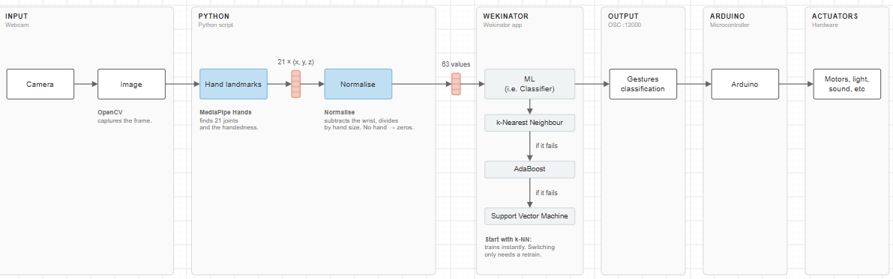

# CPS Interactive Shadow Theatre — Group 20

_First draft (v0.1 of the new structure). Items marked **[TODO]** still need the team's input or evidence._

## Team members

- Ari Wang
- Christian Gutierrez
- Julia Benevides

## Table of contents

1. [How it works](#1-how-it-works)
2. [System design](#2-system-design)
   - [2.1 Mechanical design](#21-mechanical-design)
   - [2.2 Electrical and electronics](#22-electrical-and-electronics)
   - [2.3 Software](#23-software)
   - [2.4 Machine learning](#24-machine-learning)
3. [Debugging](#3-debugging)
4. [Project files](#4-project-files)
5. [References](#5-references)

---

# 1. How it works

## 1.1 Concept

This repository contains the design, hardware documentation, software and testing materials for our interactive shadow theatre, developed for the Cyber-Physical Systems (CPS) module.

Inspired by Plato's *Allegory of the Cave*, the project explores how light angles, mechanical movement and audience interaction can transform shadows and challenge our perception of reality.

The performance features two characters, **Catrina and Mariachi**, which move along independent rails and perform a coordinated dance in response to audience interaction.

[TODO: introduce the final installation: physical structure, mechanical movement, lighting and interactive features. Explain the "hidden layer" of the story.]


## 1.2 User interaction

The audience uses two hand gestures in front of the webcam:

| Gesture (class) | What it does |
|---|---|
| **Action** | Starts the show. Both characters travel along their rails. |
| **Heart** | While the characters are waiting (HOLD), triggers the dance. |
| None | Nothing is sent; the show continues on its own timing. |

| Step | Audience action | System response | Shadow / story effect |
|---|---|---|---|
| 1 | Shows the **action** gesture | Reflector turns on, both characters move from position 1 to position 2 and back | [TODO] |
| 2 | Shows the **heart** gesture while the characters wait | Characters meet at the centre of the stage and dance (servo rotations and wiggles) | [TODO] |
| 3 | No gesture during the wait | After the hold time the characters repeat the walk once, then exit | [TODO] |
| 4 | — | Reflector turns off; after 5 s the theatre is ready for the next visitor | [TODO] |

[TODO: why these gestures fit the story; how visitors are told what to do.]

## 1.3 Demonstration

[TODO: insert a photo or GIF of the completed installation.]

[TODO: add a link to the demonstration video.]

## 1.4 System overview

`Hand gesture → Webcam → Python (MediaPipe hand landmarks) → Wekinator (classifier) → Python bridge → Arduino → Steppers, servos, reflector → Shadow performance`

```
Webcam (or a test image)
     |
     v
landmarks_sender.py   MediaPipe -> 21 landmarks x (x, y, z) = 63 floats (normalised)
     |  OSC /wek/inputs, UDP, 127.0.0.1:6448
     v
Wekinator             classifier, k-NN, 3 classes
     |  OSC /wek/outputs, UDP, 127.0.0.1:12000
     v
bridge.py             class -> one character ('s' or 'h'), plus music
     |  USB serial, 115200 baud
     v
Arduino               stage state machine -> steppers, servos, reflector
     |  state lines, e.g. "catrina -> DANCE", back over the same serial port
     v
bridge.py             changes the music track
```

The bridge also plays the music, following the state the Arduino reports.



*Figure 1. Overall system pipeline.* [TODO: check this is the final diagram.]

---

# 2. System design
### Motion System & Character Mechanism


*Figure 1. The overall mechanical structure of theatre 

The movement system combines **a shared linear guide, independently driven carriages, and modular servo mechanisms** to create coordinated movements between Catrina and Mariachi.

The mechanism separates horizontal translation from character rotation, allowing both characters to move independently and perform expressive dance movements.

**Mechanical Motion Flow:**

`Stepper Motor → GT2 Timing Belt → Linear Carriage → SG90 Servo Module → Laser-Cut Silhouette`
### Theatre Frame

The theatre frame is constructed using **12 × 15 mm wooden strips and custom 3D-printed connectors**, secured with M3 and M4 hex bolts and nuts.

The structure is designed to fit within a maximum envelope of **575 × 345 × 275 mm (L × W × H)**, providing sufficient space for the dual-track motion system, lighting, and shadow projection.

The modular construction offers several advantages:

- **Easy Assembly:** 3D-printed connectors simplify the connection of wooden members.
- **Modularity:** Individual structural parts can be adjusted or replaced without rebuilding the entire frame.
- **Accessibility:** The open framework allows access to motors, servo modules, and wiring for inspection and troubleshooting.
- **Maintenance:** Removable connections support mechanical adjustments and component replacement during prototyping.

The structure also provides mounting positions for the linear rails, lighting system, projection screen, and exterior enclosure.


*Figure 2. Theatre frame constructed from wooden strips and custom 3D-printed connectors.


#### A. Linear Guide & Belt Transmission

The linear motion system uses **two parallel 6 mm metal guide rods shared by both character carriages**, supported by custom 3D-printed mounting components.

Each carriage is driven independently by a **28BYJ-48 geared stepper motor**, controlled through a ULN2003 driver board. Each motor drives its own GT2 timing belt and pulley system, converting rotational motion into horizontal translation.

This arrangement allows the characters to approach each other and return to their starting positions independently while sharing the same guiding structure. Mechanical limit switches establish reference positions during the homing process.

**Linear Bearing Carriage**

Each carriage contains two **LM6 linear ball bearings (6 × 12 × 19 mm)**, housed within an upper and lower 3D-printed structure secured using bolts and nuts.

An **extended 3D-printed belt clamp** connects each carriage to its corresponding GT2 timing belt. The extension keeps the belt connection as horizontal and aligned as possible, reducing unwanted pulling angles and lateral forces.

The belt is secured using bolts and nuts, allowing adjustments during assembly and tensioning.

**Key Design Considerations:**

- **Shared Linear Guide:** Reduces structural complexity and space requirements.
- **Independent Belt Drives:** Allow individual control of character movement.
  


*Figure 3. Shared dual-rod linear guide and independently driven GT2 belt transmissions.*


*Figure 4. Exploded view of the two-part linear carriage, LM6 bearings, and extended belt clamp.*

---

#### B. Modular SG90 Servo & Laser-Cut Silhouettes

The character mechanism combines **modular SG90 servo units with laser-cut silhouettes**, enabling changes in projected poses through controlled rotation.

**Modular SG90 Servo Unit**

Each sliding carriage supports an **SG90 micro servo**, housed inside a custom 3D-printed module and secured using bolts and nuts.

The servo rotates the character around a vertical axis, changing its orientation relative to the light source.

- **Quick Testing:** Individual servos can be accessed and tested to identify movement issues.
- **Easy Replacement:** Servo modules can be removed or replaced without disassembling the linear carriage.
- **Independent Maintenance:** Servo adjustments can be performed without disturbing the belt transmission or guide rods.


*Figure 5. Exploded and generated view of the modular SG90 servo housing and character mounting structure.*

**Character Design & Laser-Cut Silhouettes**

Catrina and Mariachi are designed as two contrasting dance characters inspired by traditional Mexican cultural imagery.

- **Catrina:** Her flowing dress emphasises elegant movement and changes in the projected skirt shape.
- **Mariachi:** His distinctive hat and costume create a recognisable silhouette and contrasting dance poses.

Both characters are constructed using **two intersecting laser-cut profiles**, combining perpendicular outlines into a lightweight three-dimensional assembly.


*Figure 6. Character designs, laser-cut profiles, and assembled Catrina and Mariachi silhouettes.*


### Exterior enclosure and finishing

The exterior enclosure surrounds the structural frame and conceals the internal mechanical and electronic components, creating a cohesive theatrical appearance. Wooden panels were cut to fit the frame, forming the outer casing while maintaining access to the internal mechanisms and providing a defined viewing area.

Surface finishing and painting, combined with laser-cut decorative details and red curtains, establish the theatre's visual identity and separate the performance space from its supporting structure.


*Figure 7. Exterior enclosure design and final surface finishing.*


### Design Decisions & Prototype Testing

Several design decisions were informed by early prototyping and shadow projection experiments, focusing on simplifying mechanical movement and improving visual performance.

| Design Aspect | Initial Approach / Challenge | Final Design | Reason & Impact |
|---|---|---|---|
| **Character Movement** | Traditional puppetry requires individual limb control and complex mechanisms. | Interlocking silhouettes driven by translation and rotation. | Creates changing shadow poses with fewer mechanical movements, inspired by rotational dance. |
| **Shadow Scale** | Character dimensions and projection proportions needed to be determined. | Laser-cut silhouettes of different sizes were tested. | Helped establish suitable character proportions and light-to-screen distances. |
| **Screen Material** | Different translucent materials produced varying projection effects. | Frosted translucent paper. | Selected for its balance of light transmission and shadow visibility. |
| **Lighting System** | Diffused and focused light sources were explored. | Simple direct-light arrangement without additional focusing lenses. | Reduces optical complexity while maintaining a clear shadow projection. |


*Figure 8. Prototype comparisons of character movement, silhouette scale, screen materials, and lighting conditions.*


### Assembly

The mechanical assembly follows four main stages, from structural construction and motion system integration to projection setup and final enclosure. The internal mechanisms remain accessible for testing and adjustment before the theatre is fully enclosed.

#### 1. Main Frame Assembly

1. Cut the 12 × 15 mm wooden strips to the required lengths.
2. Assemble the supporting frame using custom PLA 3D-printed connectors.
3. Secure the joints using M3/M4 bolts and nuts.
4. Check the frame alignment and stability, ensuring sufficient space for the internal mechanisms.


*Figure 9. Assembly of the wooden frame using 3D-printed connectors and bolted joints.*

#### 2. Linear Motion & Character Assembly

**Linear Carriages & Guide Rods**

1. Insert two LM6 linear bearings (6 × 12 × 19 mm) into each custom 3D-printed carriage housing and assemble the sliding platforms.
2. Prepare the modular SG90 servo holders and check their fit with the carriages.
3. Pass the two parallel 6 mm metal guide rods through the bearings of both carriages.
4. Attach the two 3D-printed rail supports and secure the guide assembly to the wooden frame using bolts and nuts.
5. Adjust the rail supports and carriage positions to maintain rod alignment and ensure smooth sliding movement.

**Servo Modules & Silhouettes**

6. Install the SG90 micro servos into their custom 3D-printed housings.
7. Mount the servo modules onto the sliding carriages and secure them using bolts and nuts.
8. Assemble the laser-cut character silhouettes and test different orientations to achieve the desired shadow poses.
9. Once the positions and projection effects are confirmed, secure the silhouette components using hot glue and attach them to the servo modules.
10. Check attachment stability and rotation clearance.

**Belt-Driven Transmission**

11. Mount the 28BYJ-48 stepper motors and timing pulleys onto the supporting frame.
12. Measure and cut the GT2 timing belts to approximately 750 mm, based on repeated fitting and adjustment during assembly.
13. Route the two independent belts around their corresponding pulleys and connect them to the sliding carriages using 3D-printed belt clamps, secured with bolts and nuts.
14. Adjust belt tension and pulley alignment, then manually check the full movement range of both carriages with the power disconnected.


*Figure 10. Assembly of the bearing-supported carriages, shared guide rods, SG90 character modules, and independent belt transmissions.*

#### 3. Screen & Lighting Installation

1. Prepare the frosted translucent paper and position it across the front projection area.
2. Secure the projection screen to the wooden frame using screws.
3. Install the light sources using custom 3D-printed mounting brackets, secured with screws.
4. Adjust the light angles and projection distances to achieve suitable shadow size and clarity.
5. Test character translation, rotation, and shadow projection before installing the exterior enclosure.


*Figure 11. Installation of the projection screen, lighting brackets, and shadow alignment.*

#### 4. Final Enclosure & Finishing

1. Complete the electrical integration and verify the operation of the stepper motors, SG90 servos, and mechanical limit switches.
2. Cut and prepare the wooden enclosure panels to fit the assembled frame.
3. Install the exterior panels after successful system testing, retaining access to internal components where necessary.
4. Complete the surface finishing and add the laser-cut decorative elements and red curtains.
5. Perform a final check of mechanical movement and shadow projection.


*Figure 12. Final enclosure installation and completed shadow theatre.*

#### Final Assembly Checklist

Before installing the exterior enclosure, a final check is conducted to ensure all mechanical components are securely assembled and functioning correctly. This helps identify potential issues while the internal system remains accessible for adjustment and maintenance.


- [x] **Frame Stability:** Wooden joints, 3D-printed connectors, bolts and nuts are securely fastened.
- [x] **Linear Motion:** Guide rods are aligned, and both carriages slide smoothly without interference.
- [x] **Belt Transmission:** GT2 belts are securely clamped, properly tensioned, and aligned with the pulleys.
- [x] **Servo & Silhouettes:** SG90 modules and character silhouettes are firmly attached, with sufficient rotation clearance.
- [x] **Motion & Homing:** Both characters move independently, and the mechanical limit switches function correctly.
- [x] **Projection & Enclosure:** The screen and lights are securely mounted, shadows remain clear, and the enclosure does not interfere with the mechanisms.

*Note: Manual mechanical checks should be performed with power disconnected. Complete powered system testing before final enclosure.*

---

## 2.2 Electrical and electronics

_This section covers the **hardware** assessment criterion._

### Bill of materials

| Component | Quantity | Purpose |
|---|---|---|
| Arduino [TODO: Nano or Nano Every — the sketches state both] | 1 | Runs the stage state machine |
| 28BYJ-48 stepper motor + driver board [TODO: driver model] | 2 | Drives each carriage along its rail |
| Servo motor [TODO: model] | 2 | Rotates each silhouette during the dance |
| Home (limit) switch | 2 | Zeroes each carriage at power-up |
| Reflector light assembly [TODO: LED type] | 1 | Light source for the shadows |
| Laptop webcam | 1 | Gesture input |
| Power bank + power board (module kit) | 1 | 5 V DC supply |
| [TODO: other parts] | | |

[TODO: reason for each part and confirmation that it is on the approved list.]

### Wiring and circuit diagram

Pin assignments, from the current stage sketch (`Code/Quick Tests/TestPuppetScene`):

| Function | Catrina | Mariachi |
|---|---|---|
| Stepper driver IN1, IN2, IN3, IN4 | 8, 9, 10, 11 | 4, 5, 6, 7 |
| Servo signal | 15 | 16 |
| Home switch (to GND, `INPUT_PULLUP`, active LOW) | 3 | 2 |
| Reflector (shared, active LOW) | 14 | 14 |


*Figure 8. Electrical circuit and hardware connections.* [TODO: circuit diagram.]

### Power estimate

[TODO: current of each stepper, servo and the reflector at idle and at peak, compared with the power bank rating. Measured values preferred.]

### Safe powering

- [TODO: confirm 5 V DC from the module power bank and power board only.]
- [TODO: confirm servos and steppers are not powered from the Arduino pins, and all grounds are common.]
- The sketch switches each stepper off (`disableOutputs`) while its servo rotates, and after the show (EXIT). [TODO: state whether this was done to limit current.]

### Electrical safety and power-on check

Before connecting or adjusting electrical components:

1. Disconnect all power sources.
2. Check for damaged cables and exposed connections.
3. Confirm that electrical components are securely mounted.
4. Verify the voltage and current requirements of motors, servos and lighting.
5. Ensure that cables will not interfere with moving mechanisms.

Before running the software:

1. Verify all electrical connections and power supply ratings.
2. Check that both carriages move freely by hand with power disconnected.
3. Ensure all moving parts are clear of cables and obstacles.
4. Power on the control system.
5. Test each motor and servo individually at low speed.
6. Verify lighting operation.

---

## 2.3 Software

### Pipeline and message formats

| Link | Protocol | Address / format |
|---|---|---|
| Webcam → `landmarks_sender.py` | USB video, MediaPipe | 21 hand landmarks × (x, y, z) |
| `landmarks_sender.py` → Wekinator | OSC over UDP | `127.0.0.1:6448`, `/wek/inputs`, 63 floats, 15 messages/s |
| Wekinator → `bridge.py` | OSC over UDP | `127.0.0.1:12000`, `/wek/outputs`, class as a float |
| `bridge.py` → Arduino | USB serial, 115200 baud | One character: `s` (class 2, action) or `h` (class 3, heart) |
| Arduino → `bridge.py` | USB serial | Text lines such as `catrina -> DANCE`, used for the music |

Do not change the ports, addresses, the 63-value order or `normalise()` without telling the team: every other script depends on them.

### Sender (`landmarks_sender.py`)

- Two modes: an image (e.g. `test_hand.jpg`, the reference test) or `--webcam`. Give **either** an image path **or** `--webcam`.
- Webcam mode: one detection and one OSC message every 1/15 s. A preview window shows the camera with the landmarks drawn; `q` / `Esc` quits.
- The landmarks are normalised: the wrist is the origin and the wrist-to-middle-finger-base distance is the scale. If no hand is found, 63 zeros are sent, so Wekinator always receives the same number of inputs.
- One hand only (`num_hands=1`); handedness is not sent.
- Options: `--host`, `--port`, `--rate` (default 30, webcam 15), `--print-values`, and for the webcam `--camera N` (another camera) and `--mirror` (flip left-right).

### Bridge (`bridge.py`)

- Class to letter (`CLASS_COMMANDS` at the top of `bridge.py`): class 2 → `s`, class 3 → `h`. Class 1 (none) sends nothing.
- `COMMAND_ENDING` is `""`, so only the character is sent. Set it to `"\n"` if the sketch reads lines.
- Keep-alive: while the same class stays, the letter is re-sent about every 250 ms (`KEEPALIVE_S`).
- Waits 2 s after opening the port, because the Arduino resets when the port opens. Arduino replies are read on a background thread.
- Options: `--serial-port` (default `COM7`), `--osc-port`, `--baud`, `--no-music`, `--dry-run` (no Arduino).

### Music

The bridge reads the Arduino's state lines (`<actor> -> <STATE>`):

| Arduino state | Music |
|---|---|
| `IDLE`, `MOVE_12`, `MOVE_21`, `HOLD` | Track 1 (`music/Track_1.mp3`), looping |
| `DANCE` (any actor) | Track 2 (`music/Track_2.mp3`), looping |
| `EXIT` (all actors) | Stops with a fade-out. The next `IDLE` starts track 1 again |
| `HOMING` | Keeps what is playing |

- `--no-music` turns the music off. If `pygame` or a track file is missing, the bridge says so and carries on without music.
- If the sketch prints the states differently, change `STATE_LINE` in `bridge.py`.


### State machine (Arduino)

Each character (actor) runs its own copy of the state machine, without blocking (`millis()`, no `delay()`):

| State | Movement |
|---|---|
| `HOMING` | First power-up only: moves slowly until the home switch is pressed, then zeroes the position |
| `IDLE` | Waits for `s` (start) |
| `MOVE_12` | Moves from position 1 to position 2. Reflector on |
| `MOVE_21` | Returns to position 1 |
| `HOLD` | Waits up to 2 s for `h` (heart) |
| `DANCE` | Both actors go to the centre; servo rotations and wiggles, stepper off while each servo moves |
| `EXIT` | Steppers off, reflector off; after 5 s back to `IDLE` |

The music for each state is in the Music table above.


*Figure 9. Performance state machine.* [TODO: state machine diagram.]

### Gating logic

- `s` is accepted only when both actors are in `IDLE` and homed; otherwise the sketch replies "Not ready, start ignored".
- `h` is accepted only while the show is running (not in `IDLE` or `HOMING`), and the dance can happen only once per show.
- The dance starts only when both actors are at the centre.

### Changes beyond the provided examples

[TODO: list what was changed or added beyond the module's example code (e.g. MediaPipe hand landmarks instead of the Processing video input, the bridge, the state machine).]

---

## 2.4 Machine learning

### Features and classes

- **Input:** 63 values per frame (21 MediaPipe hand landmarks × x, y, z), normalised for position and scale. One hand only; handedness is not sent.
- **Model:** Wekinator, 1 classifier output, **k-nearest neighbours (k-NN)**.
- **Classes:**

| Class number | Name | Dataset folder | Letter sent to the Arduino |
|---|---|---|---|
| 1 | none (no gesture) | `dataset/none` | nothing |
| 2 | action | `dataset/action` | `s` |
| 3 | heart | `dataset/heart` | `h` |

**Wekinator settings:** 63 inputs, listening on port `6448`, message `/wek/inputs`. 1 output, classifier, 3 classes, k-NN, sending to `localhost` port `12000`, message `/wek/outputs`.

**Keep these identical between training and live use.** Wekinator learns from whatever it receives while recording, so any difference makes recognition worse:

- same camera, position and lighting, as far as possible
- same mirroring: the photo dataset is **not** mirrored, so do not use `--mirror` unless the dataset was recorded mirrored
- same `normalise()` (wrist origin, wrist to middle-finger-base scale)
- one hand only; handedness is not sent
- same 63-input order

### Training data

Photo dataset in `Code/Simple Pipeline/connection_test/dataset/` (`.jpg`, `.jpeg`, `.png`, one folder per class):

| Class | Photos |
|---|---|
| none | 34 |
| action | 31 |
| heart | 27 |

Saved trained project: `wekinator/WekinatorProject/TRAINCLASSIFIER10-11-2026`.

**How the model is trained (by hand).** `dataset_sender.py` only plays the photos into Wekinator; recording and training are done in Wekinator:

1. Run `dataset_sender.py --class <name>` (e.g. `--class heart`). It shows each photo in a window and sends it for `--burst` seconds (default 5), photo after photo, in a loop.
2. In Wekinator, set the output class to the class number, press **Start recording** while the script runs, record at least one full pass of the photos, then stop. Stop the script.
3. Repeat for the other classes. Then **Train**, **Run**, and save the project in `wekinator/`.

- **Class `none`:** photos where no hand is found are **not skipped**. They are sent as 63 zeros, exactly what the live sender sends when it sees no hand, so some photos with no hand at all are included.
- **Balance:** similar numbers of photos per class, otherwise k-NN leans toward the biggest class.
- Options: `--dataset <folder>`, `--burst <seconds>`, `--rate`.

[TODO: who is in the photos, lighting and background, mirroring.]

### Why this model

[TODO: justify k-NN and hand landmarks (e.g. compared with the Processing video features). Link to the evaluation in 3.3.]

---

# 3. Debugging

## 3.1 Unit and integration tests

**Connection test** (`Code/Simple Pipeline/connection_test`): one image → landmarks → Wekinator (1 class) → bridge → Arduino LED. Pass criteria:

- The LED turns on and stays on while everything runs.
- The bridge console shows `[osc]`, `[serial] sent '1'` and `[arduino] ACK 1` lines.
- Stopping the sender or Wekinator turns the LED off within about 1 s.
- Starting the sender again turns the LED on again.

This test proves the **connection**, not gesture recognition: with only one class, Wekinator's k-NN outputs 1 for any input, even 63 zeros (no hand).

**Status of each part** (before the demo):

| Part | State |
|---|---|
| Image → landmarks → OSC → Wekinator → bridge → Arduino LED (connection test) | Built and tested |
| Live webcam capture (`landmarks_sender.py --webcam`) | Built, tested by the team |
| Training Wekinator from the photo dataset | Built |
| Testing the trained model with photos (`dataset_sender.py --test`) | Built, not yet run with new, unseen photos |
| Bridge sends `s` (action) / `h` (heart) to the Arduino | Built |
| Music from the Arduino states | Built, tested in `--dry-run`, not yet tested with the real Arduino |
| Final Arduino sketch | In progress (`Code/Quick Tests/TestPuppetScene`) |

[TODO: update this table after the demo.]

**Other tests in the repo:**

- `Code/Quick Tests/StepperMotorTest` and `TestAccelStepper`: stepper motor tests. [TODO: results.]
- `Code/Quick Tests/TestPuppetScene`: the stage state machine, driven from the Serial Monitor (`s`, `h`, `v` servos to A, `r` servos to rest).
- `bridge.py --dry-run`: music tested by typing states. [TODO: test with the real Arduino.]

**Finding the failing stage:** follow the chain in order — sender status line, Wekinator input indicator, bridge `[osc]` lines, bridge `[serial] sent` lines, Arduino output. The first silent link is the one to fix.

## 3.2 Mechanical and electrical issues

| Symptom | Likely cause | Action |
|---|---|---|
| Sketch prints "Error, check limit switch" and the actor stops | Home switch not reached within the rail travel | Check the switch wiring and the homing direction |
| [TODO] | | |

## 3.3 Software and communication issues

| Symptom | Likely cause | Action |
|---|---|---|
| Bridge cannot open the COM port | Arduino IDE Serial Monitor or another bridge is using it | Close the Serial Monitor; only one program can hold the port |
| Port 12000 busy | Bridge and `dataset_sender.py --test` both listen on it | Run only one of them |
| Camera does not open | Another program (Zoom, Teams) is using it | Close the other program |
| Recognition gets worse live | Camera, lighting or mirroring differs from training | Keep the same set-up and `--mirror` setting as the dataset |
| `[music]` message and no sound | `pygame` not installed, or a track file is missing | Install `pygame` in the `cps` environment; check `music/Track_1.mp3` and `Track_2.mp3` |
| `serial.Serial` fails | The package called `serial` was installed instead of `pyserial` | Uninstall `serial`, install `pyserial==3.5` |
| Bridge sends nothing | Wekinator is not in Run mode, or only class 1 (none) is recognised | Check the Wekinator input indicator and the bridge `[osc]` lines |
| [TODO] | | |

## 3.4 ML formal evaluation

`dataset_sender.py --test --classes none,action,heart` sends random photos and compares the true class with Wekinator's answer.

- Wekinator in Run mode, bridge **stopped** (both use port 12000).
- The window draws the landmarks, shows the true class and Wekinator's answer (green = right, red = wrong or no answer). The console prints a score line per photo.
- Testing with the **training photos** looks almost perfect and proves little. A real accuracy figure needs **new photos** in a separate folder (`dataset_test/none`, `dataset_test/action`, `dataset_test/heart`), used with `--dataset dataset_test`.
- Option: `--listen-port`.

[TODO: run with **unseen** photos (`--dataset dataset_test`) and add the confusion matrix and accuracy per class. Compare two models or datasets if possible.]

## 3.5 Unseen users and set-up time

[TODO: results with people not in the training data; timed set-up (≤ 15 min).]

## 3.6 Improvements and limitations

_Maximum 200 words._

[TODO]

---

# 4. Project files

## 4.1 How to run

### Software needed

| Software / library | Version | Purpose |
|---|---|---|
| Python (conda environment `cps`) | 3.11 | Sender and bridge scripts |
| mediapipe | 1.1.1 | Hand landmarks |
| python-osc | 1.9.3 | OSC send/receive |
| pyserial (never `serial`) | 3.5 | Serial port |
| pygame | 2.6.1 | Music |
| Wekinator | [TODO] | Classifier |
| Arduino IDE + AccelStepper, Servo | [TODO] | Stage sketch |

Pinned versions are in `Code/Simple Pipeline/connection_test/environment.yml`.

### First-time set-up (once per computer)

**1. Install the tools**

1. **Anaconda** (Windows installer from anaconda.com). Choose "Just Me". "Add Anaconda to PATH" is not needed: PyCharm finds it by itself.
2. **PyCharm** (Community or Professional, from jetbrains.com). Both can use conda environments.
3. **Arduino IDE**, then *Tools > Board > Boards Manager* and install **Arduino megaAVR Boards** (for the Arduino Nano Every).
4. **Wekinator** (desktop app, from wekinator.org). Java is bundled with the current download. If Windows Firewall asks about Java, allow it on private networks.
5. **Git**, and a clone of this repository.

**2. Open the project in PyCharm**

1. *File > Open* and choose `Code/Simple Pipeline/connection_test`. This folder is the project; do not create a new project or sub-folder.
2. PyCharm creates a `.idea/` folder. It must not be committed.

**3. Create the Python environment**

1. *File > Settings > Project: connection_test > Python Interpreter*.
2. **Add Interpreter > Add Local Interpreter > Conda Environment**.
3. **Conda executable:** if empty, browse to `...\anaconda3\Scripts\conda.exe` (usually `C:\Users\<you>\anaconda3\Scripts\conda.exe`).
4. **Create new environment**, **Python 3.11**, name `cps`, then **OK**. (To reuse an existing environment, choose **Use existing environment**.)
5. The bottom-right corner of PyCharm must show the new interpreter (`cps`, Python 3.11).

**4. Install the packages**

Open the PyCharm terminal (`Alt+F12`). Check that it uses the `cps` environment:

    python -c "import sys; print(sys.executable)"

If the path is not inside `cps`, open a **new** terminal tab after setting the interpreter. Then install, always with `python -m pip`:

    python -m pip install mediapipe==1.1.1 python-osc==1.9.3 pyserial==3.5 pygame==2.6.1

Install **`pyserial`, never `serial`**. Both import as `serial`, but the package called `serial` is a different project and `serial.Serial` then fails.

Check that everything imports (prints `True`):

    python -c "import mediapipe, pythonosc, serial, pygame; print(hasattr(serial, 'Serial'))"

Alternative (only if the team agrees): `conda env create -f environment.yml` from the Anaconda Prompt.

**5. PyCharm run configurations**

A run configuration is PyCharm's saved version of a terminal command: interpreter + script + parameters. Create one per script with *Run > Edit Configurations > + > Python*: set the name, the script, the parameters, the working directory (the `connection_test` folder) and the `cps` interpreter.

| Name | Script | Parameters |
|---|---|---|
| `sender hand` | `landmarks_sender.py` | `test_hand.jpg` |
| `sender no hand` | `landmarks_sender.py` | `no_hand.jpg` |
| `sender webcam` | `landmarks_sender.py` | `--webcam` |
| `bridge dry run` | `bridge.py` | `--dry-run` |
| `bridge` | `bridge.py` | `--serial-port COM7` (use your port) |
| `dataset heart` / `dataset action` / `dataset none` | `dataset_sender.py` | `--class heart` / `--class action` / `--class none` |
| `dataset test` | `dataset_sender.py` | `--test --classes none,action,heart` |

Different configurations run at the same time in separate tabs of the Run window, each with its own Stop button. Tick **Allow multiple instances** (under *Modify options*) only to start the *same* configuration twice.

**6. Find the COM port**

Arduino IDE > *Tools > Port*, or Device Manager > Ports (COM & LPT). It differs on every computer and can change with another USB socket. It goes in the bridge's `--serial-port` parameter, not in the code.

**7. Arduino IDE**

1. *Tools > Board*: **Arduino Nano Every**. [TODO: confirm the board — `TestPuppetScene` says Arduino Nano.]
2. *Tools > Port*: the board's COM port.
3. Open the sketch and **Upload**.
4. **Close the Serial Monitor** afterwards. Only one program can hold the port.

### Run order (every time)

1. Upload the Arduino sketch with the Serial Monitor **closed**. [TODO: final sketch path.]
2. Start `bridge` (`--serial-port <your COM port>`). Wait for the `[music] ready` line.
3. Open the trained Wekinator project and press **Run**.
4. Start `sender webcam` (`--webcam`).

Stop each script with the Stop button in its PyCharm tab (or `q` / `Esc` in the preview window).

**Rules**

- Only one program can hold the Arduino COM port: close the Serial Monitor before starting the bridge, and only one team member's bridge can use the board at a time.
- Only one program can listen on port 12000: do not run `dataset_sender.py --test` together with the bridge.
- The COM port is a run parameter, not a code change. Each person keeps their own run configurations.

**Connection test only** (one image, built-in LED): upload `connection_test/connection_test.ino`, start `bridge`, start Wekinator with the 1-class project and press **Run**, then start `sender hand`. Pass criteria are in 3.1.

[TODO: shutdown steps and the 15-minute set-up checklist.]

## 4.2 Repository structure

| Path | Contents |
|---|---|
| `Code/Simple Pipeline/connection_test/` | Working pipeline: `landmarks_sender.py`, `dataset_sender.py`, `bridge.py`, dataset, music, Wekinator project, guides |
| `Code/Quick Tests/TestPuppetScene/` | Current stage sketch (state machine) |
| `Code/Quick Tests/StepperMotorTest/`, `TestAccelStepper/` | Stepper tests |
| `Code/Arduino/stageControl/` | [TODO: final single Arduino sketch] |
| `Code/Hand_Landmark_Test/`, `Code/Python/` | Early MediaPipe hand landmark tests |
| `Code/Processing/` | Processing video input example (100 inputs) |
| `Code/Wekinator/` | [TODO] |
| `STAGE/` | [TODO: CAD and fabrication files] |
| `media/` | [TODO: create — photos, diagrams and videos referenced in this README] |

**Inside `Code/Simple Pipeline/connection_test/`:**

| File | What it is |
|---|---|
| `environment.yml` | Pinned package versions (Python 3.11, mediapipe, python-osc, pyserial, pygame) |
| `check_env.py` | Import check for the environment |
| `landmarks_sender.py` | Image or webcam → 63 floats → OSC `/wek/inputs` |
| `dataset_sender.py` | Plays the photo dataset into Wekinator (training) or tests the trained model (`--test`) |
| `bridge.py` | OSC `/wek/outputs` → serial (class 2 → `s`, class 3 → `h`), plus music |
| `dataset/<class>/` | Training photos per class (`none`, `action`, `heart`) |
| `music/` | `Track_1.mp3`, `Track_2.mp3` |
| `connection_test/connection_test.ino` | Arduino connection test sketch (folder name = file name) |
| `wekinator/` | Saved Wekinator projects |
| `hand_landmarker.task`, `test_hand.jpg`, `no_hand.jpg` | MediaPipe model and test images |
| `LEARNING_LOG.md` | What was built and learned, for the contribution log and AI-use notice |

`.idea/` folders (PyCharm) must not be committed. [TODO: add `.idea/` to `.gitignore`.]

---

# 5. References

## 5.1 Citations

- Plato, *Allegory of the Cave* (conceptual inspiration). [TODO: full reference]
- Wekinator — wekinator.org. [TODO: full reference]
- MediaPipe Hand Landmarker (Google). [TODO: full reference]
- AccelStepper library. [TODO: full reference]
- [TODO: module example code, datasheets, image and music credits]

## 5.2 AI-use notice

Generative AI (Claude, Anthropic) was used in this project. What it was used for, and what each team member wrote, is recorded in `Code/Simple Pipeline/connection_test/LEARNING_LOG.md`. Claude also helped restructure this README.

[TODO: complete for all parts of the project and all team members.]

## 5.3 Team contributions

| Area | Owner |
|---|---|
| Wekinator training | Julia Benevides, Ari Wang |
| Arduino sketch | Christian Gutierrez |
| Music | Ari Wang |
| [TODO: mechanical build, Python pipeline, README, other areas] | |
