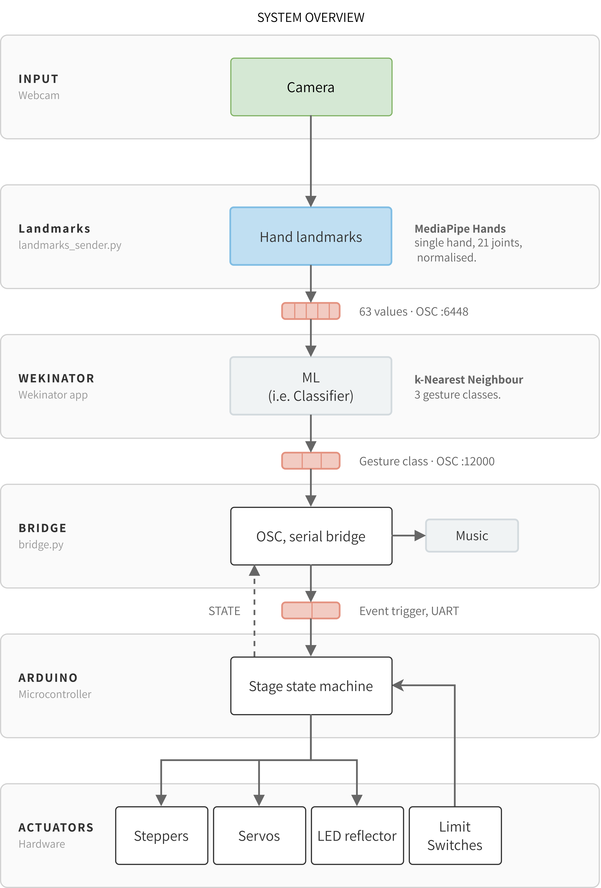
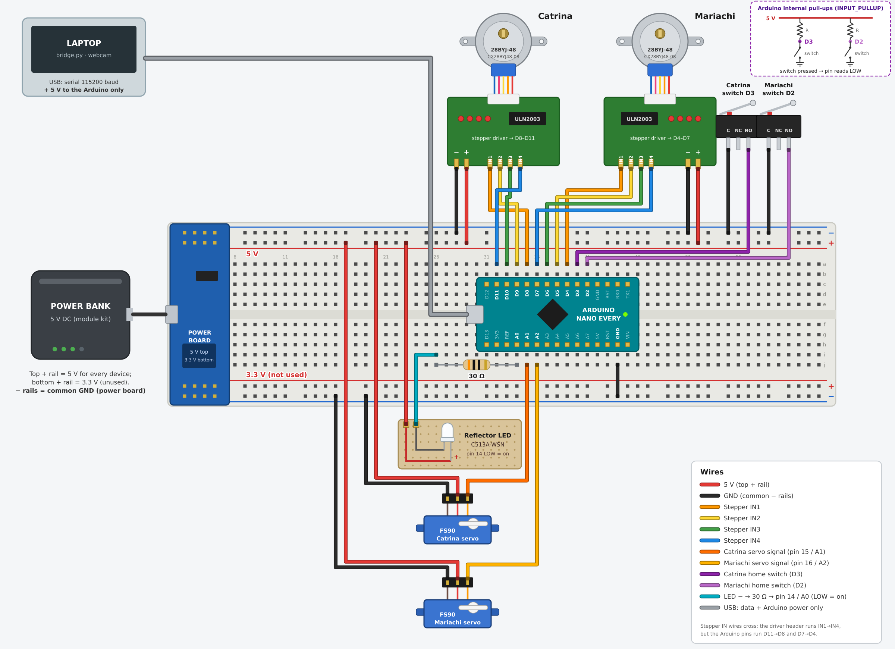
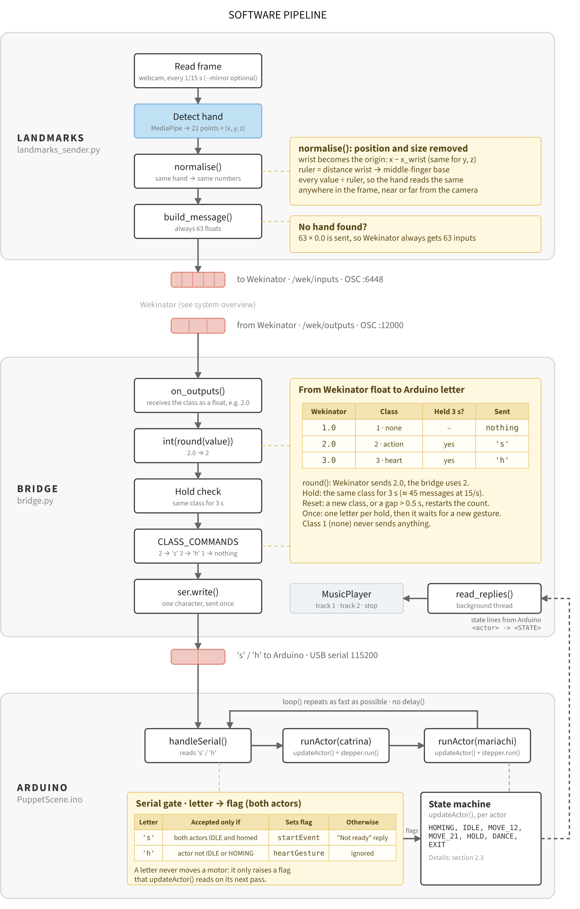
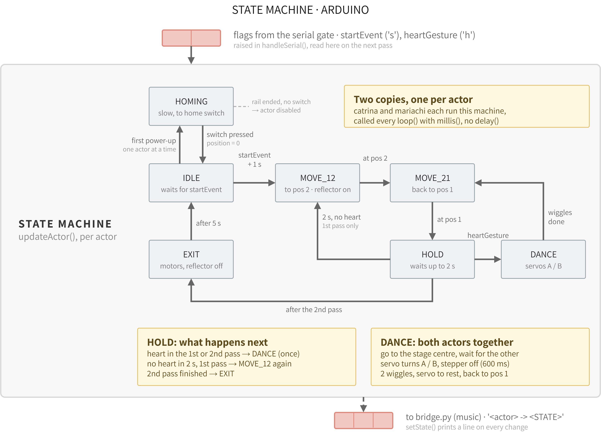

# CPS Interactive Shadow Theatre — Group 20

An interactive, gesture-controlled shadow theatre inspired by Día de los Muertos, where a HEART hand gesture brings Catrina and Mariachi together to dance.

<p align-"center">

</p>

_First draft (v0.1 of the new structure). Items marked **[TODO]** still need the team's input or evidence._

## Team members

- Ari Wang
- Christian Gutierrez
- Julia Benevides

## Table of contents

1. [How it works](#1-how-it-works)
2. [System design](#2-system-design)
   - [2.1 Mechanical design](#21-mechanical-design)
   - [2.2 Electrical and electronics](#22-electrical-and-electronics)
   - [2.3 Software](#23-software)
   - [2.4 Machine learning](#24-machine-learning)
3. [Debugging](#3-debugging)
4. [Project files](#4-project-files)
5. [References](#5-references)

---

# 1. How it works

## 1.1 Concept

This repository contains the design, hardware documentation, software and testing materials for our interactive shadow theatre, developed for the Cyber-Physical Systems (CPS) module.

Inspired by Plato's *Allegory of the Cave*, the project explores how light angles, mechanical movement and audience interaction can transform shadows and challenge our perception of reality.

The performance features two characters, **Catrina and Mariachi**, which move along independent rails and perform a coordinated dance in response to audience interaction.

Inspired by the Mexican celebration of "Día de los Muertos" (Day of the Dead), the shadow theatre tells the story of Catrina and Mariachi, two characters brought together through music, movement and the possibility of love. As the theatre comes to life, the audience can influence how their story unfolds through simple hand gestures. By performing the **HEART** gesture, the audience brings the two characters together, allowing them to share a romantic dance. Without this interaction, they continue on their separate paths, leaving their story unresolved. The performance celebrates love, remembrance and the idea that connections can transcend the boundaries between life and death.

## 1.2 User interaction

The audience uses two hand gestures in front of the webcam:
<p align="center">

</p>


| Gesture (class) | What it does |
|---|---|
| **ACTION** | Starts the show. Both characters travel along their rails. |
| **HEART** | While the characters are waiting (HOLD), triggers the dance. |
| None | Nothing is sent; the show continues on its own timing. |

| Step | Audience action | System response | 
|---|---|---|
| 1 | Shows the **ACTION** gesture | Reflector turns on, both characters move from position 1 to position 2 and back | 
| 2 | Shows the **HEART** gesture while the characters wait | Characters meet at the centre of the stage and dance (servo rotations and wiggles) |
| 3 | No gesture during the wait | After the hold time the characters repeat the walk once, then exit | 
| 4 | — | Reflector turns off; after 5 s the theatre is ready for the next visitor |

The **ACTION** gesture is often used in films and photos as a frame, a way to focus on an object. Which creates a fun interaction with the audience because it is as if they are directing the play.

The **HEART** gesture was chosen as a way to show and spread the love, then if you don't hold it long enough, their love doesn't grow for each other.

## 1.3 Demonstration

<p align=center>

</p>

[Watch on YouTube](https://youtu.be/l4lxOTiHyzY)
[](https://www.youtube.com/watch?v=l4lxOTiHyzY)


## 1.4 System overview

The system turns a hand gesture into movement and light on the stage. Six phases, from the webcam to the actuators, pass data along the pipeline, and the Arduino excecutes and reports back the current state so the music changes to match the scene.

<p align="center">
   
   Figure 1. Overall system pipeline. 
</p>

| Stage | Component | What it does | Output |
|---|---|---|---|
| Input | Webcam | Films the user's hand | Video frames |
| Hand tracking | `landmarks_sender.py` (MediaPipe) | Finds 21 hand joints and normalises them | 63 values, OSC port 6448 |
| Classification | Wekinator (k-NN) | Sorts the hand shape into one of 3 gesture classes | Gesture class, OSC port 12000 |
| Bridge | `bridge.py` | Turns the class into a command and plays the music for the current scene | `s` or `h`, USB serial at 115200 baud |
| Control | Arduino (one sketch) | Runs the stage state machine and reports the current scene back to the bridge (dashed arrow) | Motor and light commands |
| Actuators | Steppers, servos, LED reflector | Move the shadow shapes and light each scene | Movement and light on stage |


# 2. System design

## 2.1 Mechanical design

### Motion System & Character Mechanism
<p align="center">

</p>

<p align="center">

</p>

*Figure 2. The overall mechanical structure of theatre.*

The movement system combines **a shared linear guide, independently driven carriages, and modular servo mechanisms** to create coordinated movements between Catrina and Mariachi.

The mechanism separates horizontal translation from character rotation, allowing both characters to move independently and perform expressive dance movements.

**Mechanical Motion Flow:**

`Stepper Motor → GT2 Timing Belt → Linear Carriage → SG90 Servo Module → Laser-Cut Silhouette`

### Theatre Frame

The theatre frame is constructed using **12 × 15 mm wooden strips and custom 3D-printed connectors**, secured with M3 and M4 hex bolts and nuts.

The structure is designed to fit within a maximum envelope of **575 × 345 × 275 mm (L × W × H)**, providing sufficient space for the dual-track motion system, lighting, and shadow projection.

The modular construction offers several advantages:

- **Easy Assembly:** 3D-printed connectors simplify the connection of wooden members.
- **Modularity:** Individual structural parts can be adjusted or replaced without rebuilding the entire frame.
- **Accessibility:** The open framework allows access to motors, servo modules, and wiring for inspection and troubleshooting.
- **Maintenance:** Removable connections support mechanical adjustments and component replacement during prototyping.

The structure also provides mounting positions for the linear rails, lighting system, projection screen, and exterior enclosure.

<p align = center>


*Figure 3. Theatre frame constructed from wooden strips and custom 3D-printed connectors.*
</p>

#### A. Linear Guide & Belt Transmission

The linear motion system uses **two parallel 6 mm metal guide rods shared by both character carriages**, supported by custom 3D-printed mounting components.

Each carriage is driven independently by a **28BYJ-48 geared stepper motor**, controlled through a ULN2003 driver board. Each motor drives its own GT2 timing belt and pulley system, converting rotational motion into horizontal translation.

This arrangement allows the characters to approach each other and return to their starting positions independently while sharing the same guiding structure. Mechanical limit switches establish reference positions during the homing process.

**Linear Bearing Carriage**

Each carriage contains two **LM6 linear ball bearings (6 × 12 × 19 mm)**, housed within an upper and lower 3D-printed structure secured using bolts and nuts.

An **extended 3D-printed belt clamp** connects each carriage to its corresponding GT2 timing belt. The extension keeps the belt connection as horizontal and aligned as possible, reducing unwanted pulling angles and lateral forces.

The belt is secured using bolts and nuts, allowing adjustments during assembly and tensioning.

**Key Design Considerations:**

- **Shared Linear Guide:** Reduces structural complexity and space requirements.
- **Independent Belt Drives:** Allow individual control of character movement.

    <p align=center>
    

    *Figure 4. Shared dual-rod linear guide and independently driven GT2 belt transmissions.*
    </p>
    <p align=center>
    
        
    *Figure 5. Exploded view of the two-part linear carriage, LM6 bearings, and extended belt clamp.*
    </p>
---

#### B. Modular SG90 Servo & Laser-Cut Silhouettes

The character mechanism combines **modular SG90 servo units with laser-cut silhouettes**, enabling changes in projected poses through controlled rotation.

**Modular SG90 Servo Unit**

Each sliding carriage supports an **SG90 micro servo**, housed inside a custom 3D-printed module and secured using bolts and nuts.

The servo rotates the character around a vertical axis, changing its orientation relative to the light source.

- **Quick Testing:** Individual servos can be accessed and tested to identify movement issues.
- **Easy Replacement:** Servo modules can be removed or replaced without disassembling the linear carriage.
- **Independent Maintenance:** Servo adjustments can be performed without disturbing the belt transmission or guide rods.

<p align=center>


*Figure 6. Exploded and generated view of the modular SG90 servo housing and character mounting structure.*
</p>

**Character Design & Laser-Cut Silhouettes**

Catrina and Mariachi are designed as two contrasting dance characters inspired by traditional Mexican cultural imagery.

- **Catrina:** Her flowing dress emphasises elegant movement and changes in the projected skirt shape.
- **Mariachi:** His distinctive hat and costume create a recognisable silhouette and contrasting dance poses.

Both characters are constructed using **two intersecting laser-cut profiles**, combining perpendicular outlines into a lightweight three-dimensional assembly.


## Character Inspiration

<p align = center>
    
    
    *Figures 7.1 Character Design Inspiration 1*
</p>
<p align = center>  
    
    
    *Figures 7.2 Character Design Inspiration 2*
</p>

## Laser-cut Profiles

Free hand drawn on a digital painting software, then processed using image tracing to turn it into vector lines. 
Manually adding 1mm rectangles onto the vector lines to create the registation slits.


*Figures 7.3-7.4 Laser-Cut Profiles*

## Assembled Figures

Assembled at 90 degree angles, the two frames of each actor slide into place.
Using hot glue to adhere them together, then mounting them on the servo mounts.
<p align=center>

Figures 7.5-7.6 Assembled Silhouttes
</p>

### Exterior enclosure and finishing

The exterior enclosure surrounds the structural frame and conceals the internal mechanical and electronic components, creating a cohesive theatrical appearance. Wooden panels were cut to fit the frame, forming the outer casing while maintaining access to the internal mechanisms and providing a defined viewing area.

Surface finishing and painting, combined with laser-cut decorative details and red curtains, establish the theatre's visual identity and separate the performance space from its supporting structure.


*Figure 8. Exterior enclosure design and final surface finishing.*

### Design Decisions & Prototype Testing

Several design decisions were informed by early prototyping and shadow projection experiments, focusing on simplifying mechanical movement and improving visual performance.

| Design Aspect | Initial Approach / Challenge | Final Design | Reason & Impact |
|---|---|---|---|
| **Character Movement** | Traditional puppetry requires individual limb control and complex mechanisms. | Interlocking silhouettes driven by translation and rotation. | Creates changing shadow poses with fewer mechanical movements, inspired by rotational dance. |
| **Shadow Scale** | Character dimensions and projection proportions needed to be determined. | Laser-cut silhouettes of different sizes were tested. | Helped establish suitable character proportions and light-to-screen distances. |
| **Screen Material** | Different translucent materials produced varying projection effects. | Frosted translucent paper. | Selected for its balance of light transmission and shadow visibility. |
| **Lighting System** | Diffused and focused light sources were explored. | Simple direct-light arrangement without additional focusing lenses. | Reduces optical complexity while maintaining a clear shadow projection. |

*Figure 9. Prototype comparisons of character movement, silhouette scale, screen materials, and lighting conditions.* [TODO: add image to `Media/`.]

### Assembly

The mechanical assembly follows four main stages, from structural construction and motion system integration to projection setup and final enclosure. The internal mechanisms remain accessible for testing and adjustment before the theatre is fully enclosed.

#### 1. Main Frame Assembly

1. Cut the 12 × 15 mm wooden strips to the required lengths.
2. Assemble the supporting frame using custom PLA 3D-printed connectors.
3. Secure the joints using M3/M4 bolts and nuts.
4. Check the frame alignment and stability, ensuring sufficient space for the internal mechanisms.

*Figure 10. Assembly of the wooden frame using 3D-printed connectors and bolted joints.* [TODO: add image to `Media/`.]

#### 2. Linear Motion & Character Assembly

**Linear Carriages & Guide Rods**

1. Insert two LM6 linear bearings (6 × 12 × 19 mm) into each custom 3D-printed carriage housing and assemble the sliding platforms.
2. Prepare the modular SG90 servo holders and check their fit with the carriages.
3. Pass the two parallel 6 mm metal guide rods through the bearings of both carriages.
4. Attach the two 3D-printed rail supports and secure the guide assembly to the wooden frame using bolts and nuts.
5. Adjust the rail supports and carriage positions to maintain rod alignment and ensure smooth sliding movement.

**Servo Modules & Silhouettes**

6. Install the SG90 micro servos into their custom 3D-printed housings.
7. Mount the servo modules onto the sliding carriages and secure them using bolts and nuts.
8. Assemble the laser-cut character silhouettes and test different orientations to achieve the desired shadow poses.
9. Once the positions and projection effects are confirmed, secure the silhouette components using hot glue and attach them to the servo modules.
10. Check attachment stability and rotation clearance.

**Belt-Driven Transmission**

11. Mount the 28BYJ-48 stepper motors and timing pulleys onto the supporting frame.
12. Measure and cut the GT2 timing belts to approximately 750 mm, based on repeated fitting and adjustment during assembly.
13. Route the two independent belts around their corresponding pulleys and connect them to the sliding carriages using 3D-printed belt clamps, secured with bolts and nuts.
14. Adjust belt tension and pulley alignment, then manually check the full movement range of both carriages with the power disconnected.

*Figure 11. Assembly of the bearing-supported carriages, shared guide rods, SG90 character modules, and independent belt transmissions.* [TODO: add image to `Media/`.]

#### 3. Screen & Lighting Installation

1. Prepare the frosted translucent paper and position it across the front projection area.
2. Secure the projection screen to the wooden frame using screws.
3. Install the light sources using custom 3D-printed mounting brackets, secured with screws.
4. Adjust the light angles and projection distances to achieve suitable shadow size and clarity.
5. Test character translation, rotation, and shadow projection before installing the exterior enclosure.

*Figure 12. Installation of the projection screen, lighting brackets, and shadow alignment.* [TODO: add image to `Media/`.]

#### 4. Final Enclosure & Finishing

1. Complete the electrical integration and verify the operation of the stepper motors, SG90 servos, and mechanical limit switches.
2. Cut and prepare the wooden enclosure panels to fit the assembled frame.
3. Install the exterior panels after successful system testing, retaining access to internal components where necessary.
4. Complete the surface finishing and add the laser-cut decorative elements and red curtains.
5. Perform a final check of mechanical movement and shadow projection.

*Figure 13. Final enclosure installation and completed shadow theatre.* [TODO: add image to `Media/`.]

#### Final Assembly Checklist

Before installing the exterior enclosure, a final check is conducted to ensure all mechanical components are securely assembled and functioning correctly. This helps identify potential issues while the internal system remains accessible for adjustment and maintenance.

- [x] **Frame Stability:** Wooden joints, 3D-printed connectors, bolts and nuts are securely fastened.
- [x] **Linear Motion:** Guide rods are aligned, and both carriages slide smoothly without interference.
- [x] **Belt Transmission:** GT2 belts are securely clamped, properly tensioned, and aligned with the pulleys.
- [x] **Servo & Silhouettes:** SG90 modules and character silhouettes are firmly attached, with sufficient rotation clearance.
- [x] **Motion & Homing:** Both characters move independently, and the mechanical limit switches function correctly.
- [x] **Projection & Enclosure:** The screen and lights are securely mounted, shadows remain clear, and the enclosure does not interfere with the mechanisms.

*Note: Manual mechanical checks should be performed with power disconnected. Complete powered system testing before final enclosure.*

---

## 2.2 Electrical and electronics

An Arduino runs the stage, driving two stepper motors, two servos, two home switches and an LED reflector from a 5 V power bank, and this section covers the parts, wiring, power and safety checks.

### Core components - E-BOM

Each component was chosen to make the shadow show precise, repeatable and clearly visible. Every part runs from the same 5 V supply.

| Component | Quantity | Purpose | Why this part |
|---|---|---|---|
| Arduino Nano Every — `PuppetScene.ino` | 1 | Runs the stage state machine | MCU unit provided for this project |
| 28BYJ-48 stepper motor CX28BYJ48-08 + driver board | 2 | Drives each carriage along its rail | Moves each character in precise steps, so every show repeats the same dance |
| Servo motor FS90 | 2 | Rotates each silhouette during the dance | Turns quickly to set angles, changing the shadow's shape so the characters appear to dance |
| Home (limit) switch | 2 | Zeroes each carriage at power-up | Allows setting up home position to the stepper motors |
| Reflector light assembly C513A-WSN-CX0Z0231 | 1 | Light source for the shadows | Bright, with a 55° viewing angle, so this single light covers the stage and casts a sharp shadow |
| Webcam | 1 | Gesture input | Capture the gestures of the audience |
| Power bank + power board (module kit) | 1 | 5 V DC supply | Main power supply provided for this project |


### Wiring and circuit diagram

Pin assignments, from the current stage sketch (`Code/Arduino/PuppetScene`):
<p align=center>

| Function | Catrina | Mariachi |
|---|---|---|
| Stepper driver IN1, IN2, IN3, IN4 | 8, 9, 10, 11 | 4, 5, 6, 7 |
| Servo signal | 15 | 16 |
| Home switch (to GND, `INPUT_PULLUP`, active LOW) | 3 | 2 |
| Reflector (shared, active LOW) | 14 | 14 |
</p>

An Arduino Nano Every, powered and controlled over USB from the laptop, sits on a breadboard whose top rail supplies 5 V from the power board to every other device, with a common GND on both − rails.
Two ULN2003 drivers run the 28BYJ-48 steppers (Catrina on D8–D11, Mariachi on D4–D7), and two FS90 servos rotate the silhouettes (pins 15 and 16).
The home switches on D3 and D2 use the Arduino’s internal pull-ups and read LOW when pressed, and the reflector LED turns on when pin 14 goes LOW through a 30 Ω resistor.

<p align=center>

Figure 14. Electrical circuit and hardware connections.
</p>

### Power estimate

Estimated maximum consumption of the shadow theatre, from datasheet values (no measured currents).

#### General equations

Total power at the supply voltage:

$$P_{total} = V \cdot I_{total}$$

where $I_{total}$ consider the current of all the parts connected to the 5V power bank.

Resistive loads (stepper coils), Ohm's law:

$$I_{phase} = \frac{V}{R_{phase}} \qquad I_{stepper} = k \cdot I_{phase}$$

with $k$ = number of coils energised at once (2 in `FULL4WIRE` mode).

LED with a series resistor:

$$I_{LED} = \frac{V - V_F}{R}$$

#### Current per component (at 5 V)

| Component | Qty | Datasheet value | Calculation | Current per part |
|---|---|---|---|---|
| 28BYJ-48 stepper (via ULN2003) | 2 | 50 Ω ± 7 % per phase, 5 V | 5 V / 50 Ω = 100 mA per phase × 2 phases | **200 mA** (max 215 mA at 46.5 Ω) |
| FS90 servo, idle | 2 | 5 mA (4.8 V), 6 mA (6 V) | interpolated to 5 V | **5 mA** |
| FS90 servo, moving (no load) | 2 | 100 mA (4.8 V), 120 mA (6 V) | interpolated to 5 V | **103 mA** |
| FS90 servo, stalled | 2 | 700 mA (4.8 V), 800 mA (6 V) | interpolated to 5 V | **717 mA** |
| C513A-WSN LED + 30 Ω | 1 | V<sub>F</sub> = 3.2 V typ. (4.0 V max) | (5 − 3.2) / 30 Ω | **60 mA** |


Notes:

- The ULN2003 voltage drop (≈ 1 V) is ignored, so the stepper current is an upper bound.
- The sketch uses `AccelStepper::FULL4WIRE`, so **two coils are on at all times** while a stepper is enabled, also when it stands still. The steppers are only switched off (`disableOutputs`) during the DANCE servo phase and in EXIT.
- The Arduino is listed separately: As it is powered from the laptop USB, it does not load the power bank.

#### Current per state of the show

From the state machine in `PuppetScene.ino`. Arduino not included (add ≈ 20 mA if it runs from the power bank).

| State | Loads on | I<sub>total</sub> | P = 5 V × I |
|---|---|---|---|
| IDLE (after homing) | 2 steppers holding + 2 servos idle | 410 mA | 2.05 W |
| HOMING | 2 steppers (one moving, one holding) + 2 servos idle | 410 mA | 2.05 W |
| MOVE_12 / MOVE_21 / HOLD | 2 steppers + 2 servos idle + LED | **470 mA** | **2.35 W** |
| DANCE (max) | 2 steppers + 2 servos idle + LED | 470 mA | 2.35 W |
| EXIT | 2 servos idle (steppers and LED off) | 10 mA | 0.05 W |

**Normal show (maximum power consumption state):** 470 mA → **2.35 W** (490 mA, 2.45 W with the Arduino).

Note: The sketch never runs a servo and its own stepper together.

### Safe powering

- Verify that 5VDC is supplied from the module power bank and power board only.
- Confirm servos and steppers are not powered from the Arduino VCC pins, and all grounds are common.
- The sketch switches each stepper off (`disableOutputs`) while its servo rotates, and after the show (EXIT). This was done to limit current draw during the dancing state.

### Electrical safety and power-on check

>[!Important] 
>Before running the software:
>1. Verify all electrical connections and power supply ratings.
>2. Check that both carriages move freely by hand with power disconnected.
>3. Ensure all moving parts are clear of cables and obstacles.
>4. Power on the control system.
>5. Test each motor and servo individually at low speed.
>6. Verify lighting operation.

>[!Warning]
>Before connecting or adjusting electrical components:
>1. Disconnect all power sources.
>2. Check for damaged cables and exposed connections.
>3. Confirm that electrical components are securely mounted.
>4. Verify the voltage and current requirements of motors, servos and lighting.
>5. Ensure that cables will not interfere with moving mechanisms.


---

## 2.3 Software

Hand gestures seen by the webcam are tracked with MediaPipe, classified by Wekinator and passed by bridge.py to the Arduino, which moves the characters and sends its state back to control the music.

<p align="center">
     
     Figure 15. Software pipeline: Python scripts and Arduino sketch.
</p>


### Pipeline and message formats

| Link | Protocol | Address / format |
|---|---|---|
| Webcam → `landmarks_sender.py` | USB video, MediaPipe | 21 hand landmarks × (x, y, z) |
| `landmarks_sender.py` → Wekinator | OSC over UDP | `127.0.0.1:6448`, `/wek/inputs`, 63 floats, 15 messages/s |
| Wekinator → `bridge.py` | OSC over UDP | `127.0.0.1:12000`, `/wek/outputs`, class as a float |
| `bridge.py` → Arduino | USB serial, 115200 baud | One character, sent once per held gesture: `s` (start action) or `h` (dance action) |
| Arduino → `bridge.py` | USB serial | Text lines such as `catrina -> DANCE`, used for the music |

>[!Warning]
>Do not change the wekinator ports, addresses, the 63-value order or `normalise()` without telling the team: every other script depends on them.

### Sender (`landmarks_sender.py`)

- Run with `--webcam` run configuration for the show.
- Webcam mode: one detection and one OSC message every 1/15 s. A preview window shows the camera with the landmarks drawn; `q` / `Esc` quits.
- The landmarks are normalised: the wrist is the origin and the wrist-to-middle-finger-base distance is the scale. If no hand is found, 63 zeros are sent, so Wekinator always receives the same number of inputs.
- One hand only (`num_hands=1`); handedness is not sent.
- Options: `--host`, `--port`, `--rate` (default 30, webcam 15), `--print-values`, and for the webcam `--camera N` (another camera) and `--mirror` (flip left-right).

### Bridge (`bridge.py`)

- Class to letter: Wekinator sends the class as a float (e.g. `2.0`), which is rounded to an integer, then looked up in `CLASS_COMMANDS` (top of `bridge.py`): class 2 → `s`, class 3 → `h`. Class 1 (none) sends nothing.
- `COMMAND_ENDING` is `""`, so only the character is sent. Set it to `"\n"` if the sketch reads lines.
- Hold before sending: the letter is sent **once**, only after the same class has arrived for 3 s (`HOLD_S`, about 45 messages at 15/s). A different class, or a gap of more than 0.5 s (`MAX_GAP_S`), restarts the count; then the bridge waits for a new gesture.
- Waits 2 s after opening the port, because the Arduino resets when the port opens. Arduino replies are read on a background thread.
- Options: `--serial-port` (default `COM7`), `--osc-port`, `--baud`, `--no-music`, `--dry-run` (no Arduino).

### Music

The bridge reads the Arduino's state lines (`<actor> -> <STATE>`):

| Arduino state | Music |
|---|---|
| `IDLE`, `MOVE_12`, `MOVE_21`, `HOLD` | Track 1 (`music/Track_1.mp3`), looping |
| `DANCE` (any actor) | Track 2 (`music/Track_2.mp3`), looping |
| `EXIT` (all actors) | Stops with a fade-out. Track 1 starts again with the next show (`MOVE_12`) |
| `HOMING` (all actors) | No music |

Notes:
- `--no-music` run configuration turns the music off. If `pygame` or a track file is missing, the bridge says so and carries on without music.
- If the sketch prints the states differently, change `STATE_LINE` in `bridge.py`.


### State machine (Arduino)

Each character (actor) runs its own copy of the state machine, without blocking (`millis()`, no `delay()`):

| State | Movement |
|---|---|
| `HOMING` | First power-up only: moves slowly until the home switch is pressed, then zeroes the position |
| `IDLE` | Waits for `s` (start) |
| `MOVE_12` | Moves from position 1 to position 2. Reflector on |
| `MOVE_21` | Returns to position 1 |
| `HOLD` | Waits up to 2 s for `h` (heart) |
| `DANCE` | Both actors go to the centre; servo rotations and wiggles, stepper off while each servo moves |
| `EXIT` | Steppers off, reflector off; after 5 s back to `IDLE` |

The music for each state is in the Music table above.
<p align="center">
     
     Figure 16. Performance state machine.
</p>


### Gating logic

- `s` is accepted only when both actors are in `IDLE` and homed; otherwise the sketch replies "Not ready, start ignored".
- `h` is accepted only while the show is running (not in `IDLE` or `HOMING`), and the dance can happen only once per show.
- A letter never moves a motor directly: it only raises a flag for both actors (`startEvent` or `heartGesture`), which `updateActor()` reads on its next pass.
- The dance starts only when both actors are at the centre.

---

## 2.4 Machine learning

### Features and classes

- **Input:** 63 values per frame (21 MediaPipe hand landmarks × x, y, z), normalised for position and scale. One hand only; handedness is not sent.
- **Model:** Wekinator, 1 classifier output, **k-nearest neighbours (k-NN)**.
- **Classes:**

| Class number | Name | Dataset folder | Letter sent to the Arduino |
|---|---|---|---|
| 1 | none (no gesture) | `dataset/none` | nothing |
| 2 | action | `dataset/action` | `s` |
| 3 | heart | `dataset/heart` | `h` |

**Wekinator settings:** 63 inputs, listening on port `6448`, message `/wek/inputs`. 1 output, classifier, 3 classes, k-NN, sending to `localhost` port `12000`, message `/wek/outputs`.

**Keep these identical between training and live use.** Wekinator learns from whatever it receives while recording, so any difference makes recognition worse:

- same camera, position and lighting, as far as possible
- same mirroring: the photo dataset is **not** mirrored, so do not use `--mirror` unless the dataset was recorded mirrored
- same `normalise()` (wrist origin, wrist to middle-finger-base scale)
- one hand only; handedness is not sent
- same 63-input order

### Training data

The training dataset is made of single-frame photos of our team members performing each gesture (heart, action and none), plus photos of one extra person outside the team. The none class covers any hand pose that is not a heart or an action. The goal was to give the model enough variety to recognise the gestures reliably, without so many similar photos that it overfits to our own hands.

| Class | Photos |
|---|---|
| none | 34 |
| action | 31 |
| heart | 27 |

Saved trained project: `Code/Wekinator/` (`TRAINCLASSIFIER10-11-2026.wekproj`).

**How the model is trained (by hand).** `dataset_sender.py` only plays the photos into Wekinator; recording and training are done in Wekinator:

1. Run `dataset_sender.py --class <name>` (e.g. `--class heart`). It shows each photo in a window and sends it for `--burst` seconds (default 5), photo after photo, in a loop.
2. In Wekinator, set the output class to the class number, press **Start recording** while the script runs, record at least one full pass of the photos, then stop. Stop the script.
3. Repeat for the other classes. Then **Train**, **Run**, and save the project in `Code/Wekinator/`.

- **Class `none`:** photos where no hand is found are **not skipped**. They are sent as 63 zeros, exactly what the live sender sends when it sees no hand, so some photos with no hand at all are included.
- **Balance:** similar numbers of photos per class, otherwise k-NN leans toward the biggest class.
- Options: `--dataset <folder>`, `--burst <seconds>`, `--rate`.

>[!Note]
>To retrain the model, create a dataset folder at `Code/Python/dataset/` with one subfolder per class (`none`, `action`, `heart`, see the table above). Photos can be `.jpg`, `.jpeg` or `.png`.

### Why this model

Hand landmarks describe only the shape of the hand ([Features and classes](#features-and-classes)). The Processing video features from the Wekinator examples send the pixel colours of the whole image, so they change with lighting, background and where the person stands. That is a problem in a variable lighting set-up with a different audience each time. Given that landmarks remove this noise, a few dozen photos per class are enough ([Training data](#training-data)), and a simple k-NN can separate the three poses. k-NN trains in seconds, needs no tuning and can be retrained on site, which fit our short project deadline and left more time for the stage and mechanics. Its limit is that it only recognises poses close to its training examples. See [3.4 ML formal evaluation](#34-ml-formal-evaluation) for the results.

---

# 3. Debugging

## 3.1 Unit and integration tests

**Status of each part** (before the demo):

| Part | State | Technical Status |
|---|---|---|
| Live webcam capture (`landmarks_sender.py --webcam`) | Built, tested in the full pipeline | Successful, but contained blind spots due to camera placement |
| Training Wekinator from the photo dataset | Built, tested in the full pipeline | Successful |
| Testing the trained model with photos (`dataset_sender.py --test`) | Built, tested in full pipeline | Successful, but had minor amounts of incorrect distinguishing between gestures |
| Bridge sends `s` (action) / `h` (heart) to the Arduino | Built, tested in full pipeline | Successful, but contained minor inconsistencies |
| Music from the Arduino states | Built, tested in full pipeline | Successful |
| Final Arduino sketch | Built, tested in full pipeline (`Code/Arduino/PuppetScene`) | Successful, but could use fine tuning on recognition thresholds and time frames |


**Finding the failing stage:** follow the chain in order — sender status line, Wekinator input indicator, bridge `[osc]` lines, bridge `[serial] sent` lines, Arduino output. The first silent link is the one to fix.

## 3.2 Mechanical and electrical issues

| Symptom | Likely cause | Action |
|---|---|---|
| Sketch prints "Error, check limit switch" and the actor stops | Home switch not reached within the rail travel | Check the switch wiring and the homing direction |
| Carriage gets stuck or moves unevenly | Misaligned guide rods, excessive bearing friction or faulty `ULN2003` driver | Disconnect power and check carriage movement and rod alignment; if smooth, check the driver and motor connections |
| Stepper motor runs but carriage does not move | Loose `GT2` belt, slipping pulley or unsecured belt clamp | Adjust belt tension and tighten pulley and belt-clamp connections |
| Carriage vibrates during movement | Incorrect belt tension, pulley misalignment or unstable stepper operation | Check belt tension and pulley alignment; inspect motor wiring if necessary |
| `SG90` servo does not rotate | Loose wiring, incorrect signal connection or insufficient power | Check power and signal connections; test the detachable servo module separately |
| Character projects an incorrect pose | Incorrect silhouette orientation or servo rotation angle | Adjust the character position and test the servo angle under projection |
| Shadows appear blurred or doubled | Incorrect light angle, projection distance or overlapping light sources | Adjust light position and distance; test each light source separately |

>[!Warning]
>**Safety:** Disconnect power before adjusting mechanical parts. Check that moving components are clear before powered testing.

## 3.3 Software and communication issues

| Symptom | Likely cause | Action |
|---|---|---|
| Gesture is recognised but the bridge never sends | The gesture wasn't held for 3 s (`HOLD_S`), or the class flickered or the hand left the frame for more than 0.5 s (`MAX_GAP_S`), which restarts the count | Hold the pose still for over 3 s and watch the `[osc]` lines for class flicker |
| Wekinator always outputs "none" | No hand is detected, so 63 zeros are sent (hand out of frame, too dark, too far away) | Check the preview window shows landmarks on the hand; improve the lighting or move closer |
| The wrong hand is tracked | Two hands are in frame and `num_hands=1` picks one | Ask the user to show only one hand |
| Arduino replies "Not ready, start ignored" | The actors are still `HOMING`, or in the 5 s `EXIT` wait | Wait for both actors to reach `IDLE` before giving the action gesture |
| Heart gesture does nothing | The show isn't running, the 2 s `HOLD` window has passed, or the dance already happened this show | Do the heart during the `HOLD` window. Only one dance is allowed per show |
| Actors re-home every time the bridge starts | Expected: the Arduino resets when the port opens | Start the bridge before the audience arrives; a letter sent during `HOMING` is ignored |
| Music stays silent after a show | Expected after `EXIT`: Track 1 only restarts at the next `MOVE_12` | No action needed |
| Bridge crashes mid-show (`SerialException`) | The USB cable was disconnected or a loose connector dropped out | Reconnect the cable and restart the bridge; the actors will re-home |

## 3.4 ML formal evaluation

`dataset_sender.py --test --classes none,action,heart` sends random photos and compares the true class with Wekinator's answer.

- Wekinator in Run mode, bridge **stopped** (both use port 12000).
- The window draws the landmarks, shows the true class and Wekinator's answer (green = right, red = wrong or no answer). The console prints a score line per photo.
- Testing with the **training photos** looks almost perfect and proves little. A real accuracy figure needs **new photos** in a separate folder (`dataset_test/none`, `dataset_test/action`, `dataset_test/heart`), used with `--dataset dataset_test`.
- Option: `--listen-port`.

[TODO: run with **unseen** photos (`--dataset dataset_test`) and add the confusion matrix and accuracy per class. Compare two models or datasets if possible.]

## 3.5 Unseen users and set-up time

Testing with users who were not included in the original training dataset revealed some inconsistencies in gesture recognition.

### Action Gesture Recognition
<p align="center">


</p>

The **ACTION** gesture occasionally produced false activations, with the theatre turning on unexpectedly even when users were not performing the gesture. Due to the **ACTION** gestures landmarks being a common hand placement.

There were also occasional delays in recognition. For example, when attempting to turn the theatre back on immediately after it had switched off, the system sometimes took a moment to recognise the action gesture or appeared to experience a short delay before accepting the input. This affected the responsiveness and consistency of the interaction.

### Heart Gesture Recognition

<p align="center">

</p>

The **HEART** gesture was generally recognised accurately, with successful activation in most attempts. However, the requirement to maintain a recognised gesture continuously for three seconds occasionally made activation difficult.

Some participants struggled to maintain a consistent hand position for the full duration, causing interruptions in recognition before the three-second threshold could be reached. This was particularly noticeable when users moved their hands while forming the gesture.

Differences in hand size and dexterity also introduced some variation. Some participants found it more difficult to form the rounded heart shape, while others produced heart gestures with a significantly smaller circumference than those represented in the original training dataset. Although this rarely prevented successful recognition, it highlighted some limitations in the model's ability to accommodate variations in how different users perform the same gesture.

### Overall Findings

Overall, the system performed reasonably well with unseen users, particularly when gestures were performed in positions and shapes similar to the original training examples. However, testing highlighted opportunities to improve generalisation across different users, reduce false activations and make gesture recognition more tolerant of variations in hand positioning, size and movement.

These observations suggest that expanding the training dataset with a wider variety of users and gesture variations, alongside refining the activation timing and recognition thresholds, could improve the reliability and accessibility of the interaction.


### Timed Set-Up

1. Unpacking and placement:  1-2 minutes
2. Circuit and Mechanical Check : 30 seconds-3 minutes
3. Arduino, laptop, power bank, and webcam connections: 30 seconds
4. Power Cycle: 30 seconds
5. Open Applications (Wekinator, Pycharm, Arduino, Camera): 1-2 minutes
6. Ready for operation: Set up time 3 minutes 30 seconds-8 minutes


## 3.6 Improvements and limitations

| Area | Current Limitations | Potential Improvements |
|---|---|---|
| **Mechanical Movement** | Limited travel range and potential vibration during movement. | Refine belt tension and carriage alignment for smoother, more stable movement. |
| **Character Animation & Storytelling** | The current performance focuses on two characters dancing along a single shared guide. | Introduce additional tracks, background layers, and new characters to create richer movements, layered scenes, and more complex storylines. |
| **Lighting & Projection** | The current lighting setup provides limited changes in atmosphere during the performance. | Combine spotlights and general lighting with dynamic transitions to highlight characters, shift the atmosphere, and create more dramatic effects. |
| **Gesture Interaction** | Gesture recognition can be sensitive to environmental conditions. | Improve recognition reliability and introduce more varied gestures for richer audience participation. |
| **Maintenance & Accessibility** | Internal components are less accessible after the enclosure is installed. | Introduce removable enclosure panels for easier maintenance and future upgrades. |

---

# 4. Project files

## 4.1 How to run

### Software needed

| Software / library | Version | Purpose |
|---|---|---|
| Python (conda environment `cps`) | 3.11 | Sender and bridge scripts |
| mediapipe | 1.1.1 | Hand landmarks |
| python-osc | 1.9.3 | OSC send/receive |
| pyserial (never `serial`) | 3.5 | Serial port |
| pygame | 2.6.1 | Music |
| Wekinator | Latest version | Classifier |
| Arduino IDE + AccelStepper, Servo | IDE V2.3.10, AccelStepper V1.64 Serrvo V1.3.0 | Stage sketch |

Pinned versions are in `Code/Python/environment.yml`.

### First-time set-up (once per computer)

**1. Install the tools**

1. **Anaconda** (Windows installer from anaconda.com). Choose "Just Me". "Add Anaconda to PATH" is not needed: PyCharm finds it by itself.
2. **PyCharm** (Community or Professional, from jetbrains.com). Both can use conda environments.
3. **Arduino IDE**, then *Tools > Board > Boards Manager* and install **Arduino megaAVR Boards** (for the Arduino Nano Every).
4. **Wekinator** (desktop app, from wekinator.org). Java is bundled with the current download. If Windows Firewall asks about Java, allow it on private networks.
5. **Git**, and a clone of this repository.

**2. Open the project in PyCharm**

1. *File > Open* and choose `Code/Python`. This folder is the project; do not create a new project or sub-folder.
   If you set up PyCharm before the folders were reorganised, open `Code/Python` again and update the working directory of each run configuration.
2. PyCharm creates a `.idea/` folder. It must not be committed.

**3. Create the Python environment**

1. *File > Settings > Project: Python > Python Interpreter*.
2. **Add Interpreter > Add Local Interpreter > Conda Environment**.
3. **Conda executable:** if empty, browse to `...\anaconda3\Scripts\conda.exe` (usually `C:\Users\<you>\anaconda3\Scripts\conda.exe`).
4. **Create new environment**, **Python 3.11**, name `cps`, then **OK**. (To reuse an existing environment, choose **Use existing environment**.)
5. The bottom-right corner of PyCharm must show the new interpreter (`cps`, Python 3.11).

**4. Install the packages**

Open the PyCharm terminal (`Alt+F12`). Check that it uses the `cps` environment:

```shell
python -c "import sys; print(sys.executable)"
```

If the path is not inside `cps`, open a **new** terminal tab after setting the interpreter. Then install, always with `python -m pip`:

```shell
python -m pip install mediapipe==1.1.1 python-osc==1.9.3 pyserial==3.5 pygame==2.6.1
```

Install **`pyserial`, never `serial`**. Both import as `serial`, but the package called `serial` is a different project and `serial.Serial` then fails.

Check that everything imports (prints `True`):

```shell
python -c "import mediapipe, pythonosc, serial, pygame; print(hasattr(serial, 'Serial'))"
```

Alternative (only if the team agrees): `conda env create -f environment.yml` from the Anaconda Prompt.

**5. PyCharm run configurations**

A run configuration is PyCharm's saved version of a terminal command: interpreter + script + parameters. Create one per script with *Run > Edit Configurations > + > Python*: set the name, the script, the parameters, the working directory (`Code/Python`) and the `cps` interpreter.

| Name | Script | Parameters |
|---|---|---|
| `sender webcam` | `landmarks_sender.py` | `--webcam` |
| `bridge dry run` | `bridge.py` | `--dry-run` |
| `bridge` | `bridge.py` | `--serial-port COM7` (use your port) |
| `dataset heart` / `dataset action` / `dataset none` | `dataset_sender.py` | `--class heart` / `--class action` / `--class none` |
| `dataset test` | `dataset_sender.py` | `--test --classes none,action,heart` |

Different configurations run at the same time in separate tabs of the Run window, each with its own Stop button. Tick **Allow multiple instances** (under *Modify options*) only to start the *same* configuration twice.

**6. Find the COM port**

Arduino IDE > *Tools > Port*, or Device Manager > Ports (COM & LPT). It differs on every computer and can change with another USB socket. It goes in the bridge's `--serial-port` parameter, not in the code.

**7. Arduino IDE**

1. *Tools > Board*: **Arduino Nano Every**. 
2. *Tools > Port*: the board's COM port.
3. Open `Code/Arduino/PuppetScene/PuppetScene.ino` and **Upload**.
4. **Close the Serial Monitor** afterwards. ==Only one program can hold the port.==

### Run order (every time)

1. Upload `Code/Arduino/PuppetScene` with the Serial Monitor **closed**.
2. Start `bridge` (`--serial-port <your COM port>`). Wait for the `[music] ready` line.
3. Open the trained Wekinator project (`Code/Wekinator/TRAINCLASSIFIER10-11-2026.wekproj`) and press **Run**.
4. Start `sender webcam` (`--webcam`).

Stop each script with the Stop button in its PyCharm tab (or `q` / `Esc` in the preview window).

>[!Important]
>- Only one program can hold the Arduino COM port: close the Serial Monitor before starting the bridge, and only one team member's bridge can use the board at a time.
>- Only one program can listen on port 12000: do not run `dataset_sender.py --test` together with the bridge.
>- The COM port is a run parameter, not a code change. Each person keeps their own run configurations.

## 4.2 Repository structure

| Path | Contents |
|---|---|
| `Code/Python/` | Python pipeline: sender, dataset sender, bridge, dataset, music, environment |
| `Code/Wekinator/` | Trained Wekinator project used in the show (3 classes) |
| `Code/Arduino/PuppetScene/` | Stage sketch (state machine) |
| `Build/Actor Design` | Puppets DXF files |
| `Build/Final Model` | Stage CAD models |
| `Media/` | Images for this README

**Inside `Code/Python/`:**

| File | What it is |
|---|---|
| `environment.yml` | Pinned package versions (Python 3.11, mediapipe, python-osc, pyserial, pygame) |
| `check_env.py` | Import check for the environment |
| `landmarks_sender.py` | Webcam → 63 floats → OSC `/wek/inputs` |
| `dataset_sender.py` | Plays the photo dataset into Wekinator (training) or tests the trained model (`--test`) |
| `bridge.py` | OSC `/wek/outputs` → serial (class 2 → `s`, class 3 → `h`), plus music |
| `music/` | `Track_1.mp3`, `Track_2.mp3` |
| `hand_landmarker.task` | MediaPipe hand landmark model |

The scripts find `dataset/`, `music/` and `hand_landmarker.task` relative to their own folder, so `Code/Python` must be kept together.


---

# 5. References

## 5.1 Citations

- Plato, *The Republic*, Book VII, "Allegory of the Cave". [Wikipedia](https://en.wikipedia.org/wiki/Allegory_of_the_cave).
- Wekinator. Fiebrink, R. *Wekinator: Software for real-time, interactive machine learning*. [wekinator.org](http://www.wekinator.org/). Accessed 16 November 2026.
  - Fiebrink, R., Trueman, D. and Cook, P. R. (2009). "A Meta-Instrument for Interactive, On-the-Fly Machine Learning." *Proceedings of the International Conference on New Interfaces for Musical Expression (NIME)*, Pittsburgh, PA, pp. 280–285. [DOI: 10.5281/zenodo.1177513](https://doi.org/10.5281/zenodo.1177513).
- MediaPipe Hand Landmarker. Google AI Edge. *Hand landmarks detection guide*. [Google AI Edge documentation](https://developers.google.com/edge/mediapipe/solutions/vision/hand_landmarker). Accessed 16 November 2026.
  - Zhang, F., Bazarevsky, V., Vakunov, A., Tkachenka, A., Sung, G., Chang, C.-L. and Grundmann, M. (2020). "MediaPipe Hands: On-device Real-time Hand Tracking." *CVPR Workshop on Computer Vision for AR/VR*, Seattle, WA. [arXiv:2006.10214](https://arxiv.org/abs/2006.10214).
- AccelStepper library. McCauley, M. (2009–2023). *AccelStepper library for Arduino*, version [1.64]. AirSpayce Pty Ltd. GPL v2. [airspayce.com](https://www.airspayce.com/mikem/arduino/AccelStepper/). Accessed 16 November 2026.
- *La Llorona* (Mexican Folk Song). "The Artistic Value and Cultural Symbolism of La Llorona." Xiaohongshu (RED). [Source Video](https://xhslink.cn/o/1buiYKscI7y).
- *The Phantom of the Opera* (Cello Quartet Arrangement). Xiaohongshu (RED). [Source Video](https://xhslink.cn/o/igsaYjSxsw).

- Anthropic Claude. Anthropic Claude response to Group 20. 26 October to 11 November 2026.
- OpenAI ChatGPT. OpenAI ChatGPT response to Group 20. 26 October to 16 November 2026.

## 5.2 Engineering Documentation

- [28BYJ-48 5 V stepper datasheet (Kiatronics)](https://www.piekarz.pl/pdf.php?id=33958): rated 5 V, DC resistance 50 Ω ± 7 %.
- [FEETECH FS90 specification](https://www.pololu.com/file/0J1435/FS90-specs.pdf): idle, running and stall current at 4.8 V and 6 V.
- [Cree C513A-WSS/WSN datasheet](https://it.exshinetech.com/datasheets/70/C513A-WSN-CX0Z0341.pdf): I<sub>F</sub> max 30 mA, V<sub>F</sub> 3.2 V typ. / 4.0 V max at 20 mA.
- [Arduino Nano Every pinout](https://cdn.soselectronic.com/productdata/f5/1b/20adce8e/abx00033.pdf): 40 mA max per pin, 20 mA recommended.
- [Nano Every board current, ≈ 20 mA (user report)](https://github.com/arduino/ArduinoCore-megaavr/issues/137).

## 5.3 AI-use notice

Generative AI (Claude, Anthropic，Chatgpt) was used in this project by all three team members (see the Anthropic Claude references in 5.1).

- **Debugging (main use):** the Arduino IDE has no integrated debugger (no breakpoints or step-by-step execution), so Claude was our main debugging tool. We shared code, Serial Monitor output and error messages, and used its suggestions to find and fix faults. Every fix was tested by the team on the hardware.
- **Code:** Claude reviewed code written by the team, to identify any possible issues in the pipeline.
- **Learning:** explanations of the tools and concepts used (Wekinator, k-NN, OSC, serial communication, non-blocking timing).
- **CAD Rendering:** Rhino model screenshots were provided to ChatGPT to improve materials, lighting, and backgrounds for clearer mechanical visualisation.
- **Image Enhancement:** ChatGPT was used to improve image clarity and highlight component details and assembly structures.


All AI output was checked, tested and edited by the team, and the team is responsible for the final work.
